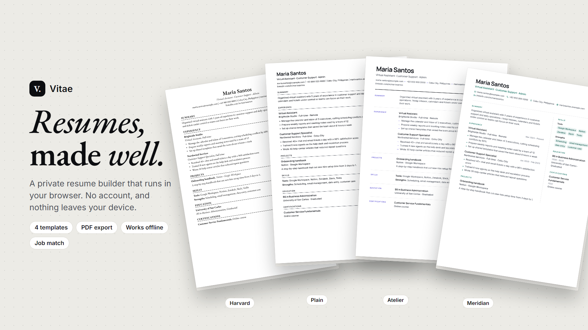
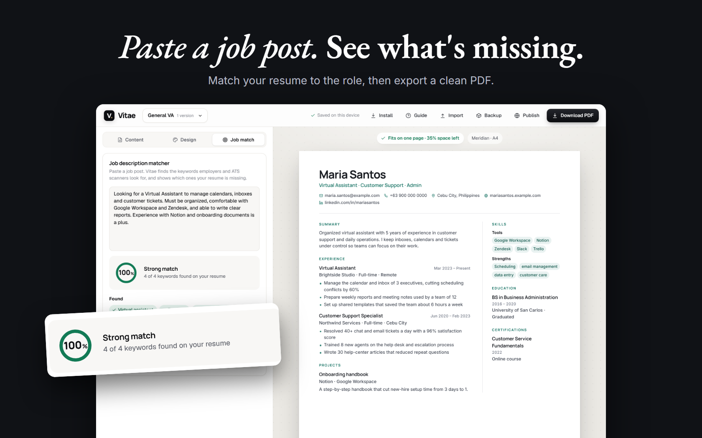

# Vitae

**A private resume builder that runs in your browser.**

## About

Vitae helps you build a polished resume in minutes. Fill in a form, watch the resume update as you type, and download it as a PDF.

There is no account, no server and no tracking. Your resume is saved on your device, and Vitae works offline and installs like an app.

**[Try it: direkjames.github.io/Vitae](https://direkjames.github.io/Vitae/)**

## Features

- **Form editor** for Profile, Summary, Experience, Projects, Skills, Education and Certifications, with a **live preview**
- **Four templates:** Meridian (modern two-column), Atelier (elegant single column), Plain (ATS-friendly) and Harvard (classic serif, Education first)
- **PDF export** in A4 or US Letter
- **One-page check** that warns you when your content spills onto a second page
- **Job description matcher:** paste a job post to see which keywords you have and which are missing
- **Multiple versions** of your resume, such as "Minecraft dev", "Web dev" or "General VA"
- **Drag to reorder** sections and entries, with a mouse, touch or the arrow keys
- **Themes:** accent colors, seven font pairings and spacing options
- **Bullet helper:** action verbs for many jobs (such as developer, teacher, BPO, retail and designer) plus tips
- **Headline separators** you can insert with one tap
- **Optional photo and personal details**, which you can switch off for international applications
- **Projects with links** to show off your work
- **Auto-save** on your device, and **backup and import** of all your versions as a file
- **Publish as a page:** export your resume as a web page you can host for free
- **Built-in guide** that opens on your first visit
- **Installable and offline**

## Getting started

1. Open [direkjames.github.io/Vitae](https://direkjames.github.io/Vitae/) in your browser.
2. Fill in your details in the **Content** tab, and pick a look in the **Design** tab.
3. Paste a job post in the **Job match** tab to see what your resume is missing.
4. Press **Download PDF**.

To use it like an app, press **Install** in your browser. To keep a copy of your work, press **Backup**.

## Requirements

- A modern web browser (Chrome, Edge, Firefox or Safari)
- An internet connection the first time, to load the fonts

## Built with

- HTML, CSS and JavaScript, with no build step and no dependencies
- A service worker and IndexedDB for offline use and saving
- [Google Fonts](https://fonts.google.com)

Want to run it yourself? See [Developing Vitae](docs/DEVELOPING.md).

## Status

Shipped.

## Credits / License

Made by [direkjames](https://github.com/direkjames). All rights reserved. See [LICENSE](LICENSE).
